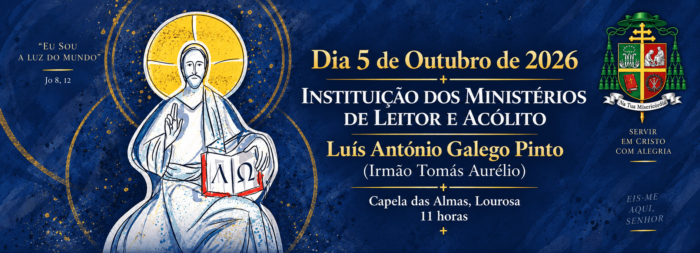
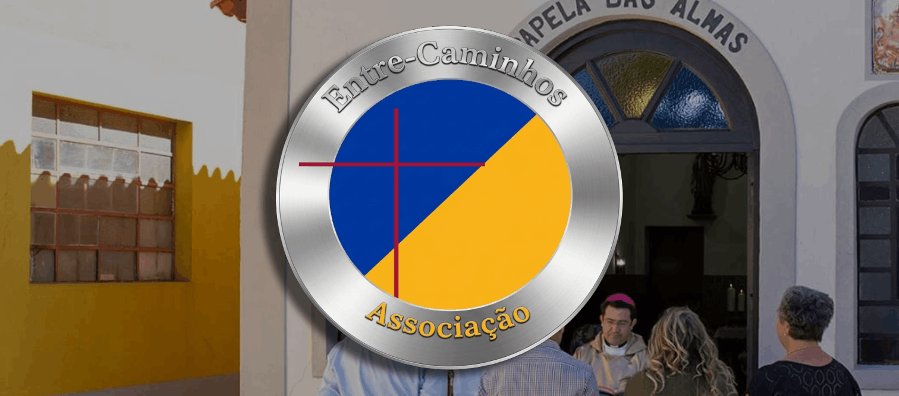
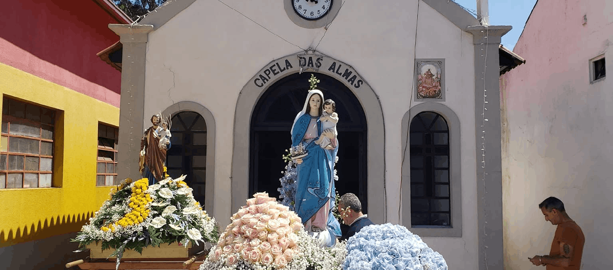
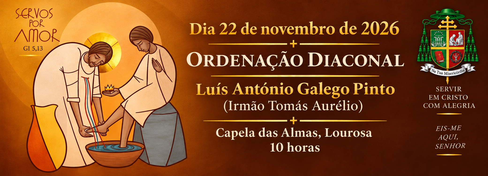
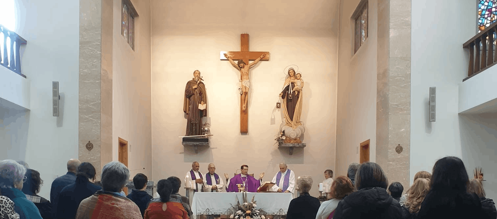
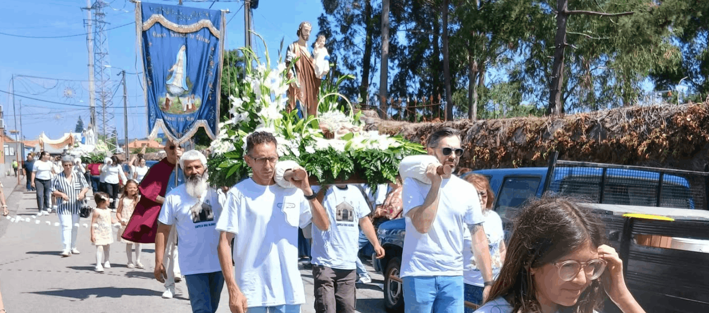

<main class="agenda-page">
<section class="page-content" aria-labelledby="agenda-title">

<!-- Instituição dos Ministérios de Leitor e Acólito -->

<time datetime="2026-10-05">
5 de Outubro de 2026
</time>

<h4>Instituição dos Ministérios de Leitor e Acólito</h4>

Será instituído nos ministérios de leitor e acólito
Luís António Galego Pinto (Irmão Tomás Aurélio, TOP),
na Capela das Almas, Lourosa, pelas 11:00.

<!-- Fundação da Associação -->

<time datetime="2026-10-14">
14 de Outubro de 2026
</time>

<h4>Fundação da Associação</h4>

Celebração da fundação da
<a href="/associacao.html">Associação Entre Caminhos</a>.

<!-- Fundação da Comunidade -->

<time datetime="2026-11-20">
20 de Novembro de 2026
</time>

<h4>Fundação da Comunidade</h4>

Celebração da data da fundação da Comunidade
da Capela das Almas.

<!-- Ordenação Diaconal -->

<time datetime="2026-11-22">
22 de Novembro de 2026
</time>

<h4>Ordenação Diaconal</h4>

Será ordenado ao grau de diácono Luís António
Galego Pinto (Irmão Tomás Aurélio, TOP), na Capela
das Almas, Lourosa, pelas 10:00.

<!--
Peregrinação Anual a Fátima.
Sem dia definido, mantém-se na agenda
até ao final de dezembro.
-->

<time datetime="2026-12">
Dezembro de 2026
</time>

<h4>Peregrinação Anual a Fátima</h4>

A grande peregrinação anual de inverno, unindo todas
as frentes pastorais e fiéis num ato solene de
consagração e oração.

<!-- Festas: a data de fim corresponde ao último dia -->

<time datetime="2027-05-28">28</time>–<time
datetime="2027-05-30"
>30 Maio 2027</time>

<h4>
Festas em Honra de Nossa Senhora da Boa Viagem
e Nossa Senhora de Fátima
</h4>
<h4 class="agenda-subtitle">Programa</h4>
<ul>
<li>Procissão de Velas</li>
<li>Procissão Solene</li>
<li>Música ao vivo com artista a designar da TV</li>
<li>Grupo de Baile</li>
<li>Duos Musicais</li>
<li>Fogo de Artifício</li>
<li>Fanfarra</li>
<li>Banda de Música</li>
<li>Bênção dos Coletes</li>
<li>Entre outras atividades</li>
</ul>
<h4 class="agenda-subtitle">Convite</h4>

<strong>
Vamos todos ajudar a realizar estas festividades!
</strong>
 
<strong>
Contamos com a colaboração e participação de todos
para tornar estas festas um grande sucesso!
</strong>

De momento, não existem eventos agendados.

<!-- A secção começa fechada por não ter o atributo "open". -->

Eventos passados

<noscript>

Ative o JavaScript para separar automaticamente
os eventos passados dos próximos eventos.

</noscript>
</section>

